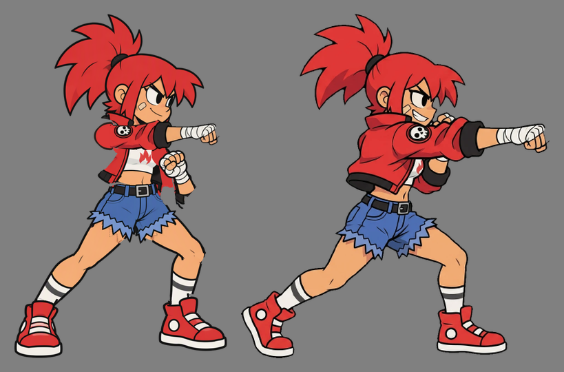

## The problem

Rhythm games rarely give repetition a physical meaning. Call and response usually means singing or dancing. I wanted a loop where repeating the boss's moves is blocking and countering them, so every note has a consequence and the player can read the fight instead of guessing at it.

## Goals / pillars

- **The fight is the music.** Every strike is a note. The cue is the boss's body and the sound of the hit.
- **Everything is tape.** The cassette is both the fiction and the interface: the Call records, the rewind is the transition, the Response is playback.
- **Fair reading.** The boss never lies. The Call shows exactly what comes back, so the challenge is memory and precision.
- **Every fight tells a story.** Dialogue sits inside the song, in rests of the chart. The music never stops.

## Process & iterations

Evidence below comes from my own playtests of each build and from a simulation script. No blind playtest with outside players has been run yet.

### 1. From a pulse-reading fight loop to call and response

**Version.** The September prototype was a fighting loop on a fixed pulse: a light hit every beat, telegraphed heavies, parry and riposte, a stagger bar.

**Change.** On 8 Nov I replaced it entirely with call and response, a simpler PaRappa-like core: Bonnie performs a phrase, the tape rewinds for one beat, and you repeat it. The old code and tests were archived, not deleted.

How I got there: the earlier version and the evidence

It was built and tested, and it asked whether a new player could read the pulse and four tells in 60 seconds.

**Evidence.** After playing it, I judged that the player had to learn the rules before acting, which clashes with "fair reading". Call and response teaches by demonstration: you answer what you just heard. So I chose that as the core and planned fighting depth as a later layer.

### 2. Finish tiers instead of boss HP

**Change.** The right arrow is the only attack, so blocking is the default and attacks are the reward for clean play. The other two arrows only block. The attack has two slots per phrase: a finisher on the last beat of the Response, and a bonus hit on the offbeat that only exists after a clean phrase. The attack percentage at the end of the song picks the result: under 20% is a TIME LIMIT DRAW, under 70% is a T.K.O., and 70% or more is a K.O. A FLAWLESS tag appears if you took no damage. I cut the stagger and FREESTYLE system that had been built at the same time, because it skipped chart phrases that still counted in the maximum score and so competed with what the game now measures.

How I got there: the earlier version and the evidence

**Version.** Boss HP of 300, with damage per hit, so the fight ended when the boss fell.

**Evidence.** A script that runs the real engine against simulated players showed about a 3x spread in damage between players. A fixed HP bar meant strong players finished early and weak ones never finished, so I chose a result that scales with performance.

### 3. Boss twists from the base loop: the walking note and claps

**Change.** In the current build a claps phrase fills the tape lane with crowd hands that close on every beat, so you cannot tell which slots hold a note. You play the rhythm you saw and the buttons from memory. Rule: one twist per section, never two in a phrase, so each one can be learned before the next.

How I got there: the earlier version and the evidence

**Version.** My first boss mechanics (a referee, a ghost, a cutscene, named moves) were too complex and needed new art, so I chose to "play with the base loop": change the rhythm and what is shown, with one input.

**Evidence, walking note.** In a playtest, a note that followed the cursor looked like a hold note. The fix was a quarter-beat dash with its own whoosh. It moves exactly on the origin beat, so the player has to trust the note's border instead of reacting to movement. Pressing at the origin is "fell for it": a miss that consumes the note.

**Evidence, claps.** Version 1 hid notes during the Call and was too hard. Version 2 moved the cover to the rewind. Version 3 added an encore and a ramp to "everything hidden", which I had not asked for and rejected because a ramp to full cover turned memory into guessing. Version 4 covered half the notes with two buttons per phrase, which I kept because short repeating patterns were readable from memory.

### 4. Feedback lands on the beat, at the input

**Version.** Hit feedback fired when the judgement resolved.

**Change.** It became the top rule, because late feedback breaks the link between the input and the music. Every sound, effect and pose fires with the input, strike effects take the colour of the button, and anticipation frames are pre-rolled so the hit frame lands on the beat.

How I got there: the earlier version and the evidence

**Evidence.** I caught it in playtest: feedback arrived about 170 ms late and the game felt off the beat.

*The chart structure, diagrammed from the design doc. Acts follow the song's real breaks, not boss HP. Decision shown: one twist per section, with dialogue in the rests.*

## Design artifacts

Show the design artifacts (4 images with captions)

*Rig spike vs sprite (11 Nov). A flat cut-out cannot twist a 3/4 torso, so the punch came out weaker. Decision: keep one sprite per strike plus a generated anticipation frame.*

*Bonnie's pose set. Her three strikes (slap, sweep, boot) are only visual variety for the three arrows, and the game never tells the player what each arrow means.*

*Arena backdrop source art (14 Nov), replacing a placeholder gym. No text appears anywhere in the background by rule.*

*One of three crowd sheets (neutral, boo and hyped). The boo and hyped sheets were edited from the neutral one, so three generations replaced eighteen. The crowd reacts as a feedback layer.*

## Result

A complete one-boss build for desktop: one authored chart for "Riot" (107.36 BPM, 31 phrases, 99 notes, 4 sections, 3 intermissions), two boss twists, a finish-tier system, calibration, an on-beat feedback layer and a live tuning panel. The core engine is deterministic and has no rendering code. 773 unit tests and 93 Python tests passed on 14 Nov 2026. This is a design prototype built to demonstrate the loop.

## What I learned / what I'd do next

- **Cut what competes with what you measure.** The stagger system worked, and it still did not belong.
- **Translate a request at the strength it was given.** Two proposals (one in code, one in art) escalated beyond what I had asked for (a claps ramp to "everything covered", and an art change that gave every frame a different face). I caught both and rolled them back.
- **Not validated yet:** whether two-bar phrases fit in memory at this tempo, whether one beat of rewind is enough, how many covered notes is right for claps, and the real spread of finish tiers. A CSV export and a metrics script are ready for a blind playtest.
- **Open:** the dialogue text is still being written, and the story beat for Section 3 is undecided. The debug tools need removing before the official recording, and a playable embed will follow.

## Credits

Concept, design decisions, specs, narrative and art direction: Bruno Santos Briseno. Code and simulations: Claude (AI assistant), from my specs. Art: generated with GPT Image and Nano Banana, then cut and packed with Python scripts. Music: "Riot" by HighHopBeatz. Sound effects: Mixkit.
