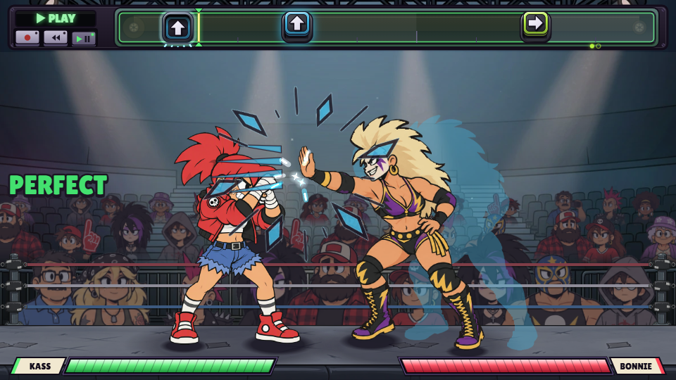
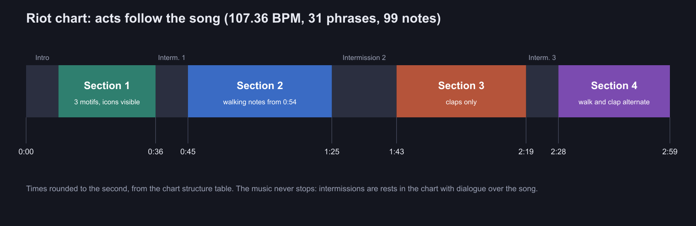
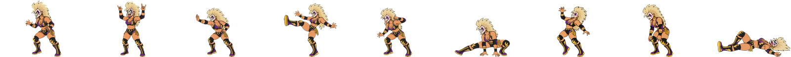

<!-- MEDIA: clips and stills are captured from a human-like autoplay run of the real game (BEATDOWN REMIX repo, `?autoplay=human`). -->

<figure class="media-hero">
  <video src="/game-design-portfolio/media/beatdown-remix/hero-loop.mp4" poster="/game-design-portfolio/media/beatdown-remix/hero-loop.jpg" autoplay muted loop playsinline preload="metadata" aria-label="Bonnie performs a phrase of strikes, the tape rewinds, and Kass answers each strike on the beat."></video>
  <figcaption>One loop: Bonnie's Call (recorded on tape), the rewind, and Kass's Response.</figcaption>
</figure>

## The problem

Rhythm games rarely give repetition a physical meaning. Call and response usually means singing or dancing. I wanted a loop where repeating the boss's moves is blocking and countering them, so every note has a consequence and the player can read the fight instead of guessing at it.

## Goals / pillars

- **The fight is the music.** Every strike is a note. The cue is the boss's body and the sound of the hit.
- **Everything is tape.** The cassette is both the fiction and the interface: the Call records, the rewind is the transition, the Response is playback.
- **Fair reading.** The boss never lies. The Call shows exactly what comes back, so the challenge is memory and precision.
- **Every fight tells a story.** Dialogue sits inside the song, in rests of the chart. The music never stops.

Want to try it? <a href="https://awkner.itch.io/beatdown-remix-demo-v01?secret=3i41o6UZr8OhftGm1uuZ3A2P3DU" rel="noopener" target="_blank">Play the Bonnie Boomin' fight in the browser on itch.io</a> (keyboard, desktop).

## How it plays

A phrase is 2, 4 or 8 beats long and runs in three parts. In the **Call**, Bonnie performs the strikes, every note visible on a tape strip, and nobody takes damage. The **Rewind** is one empty beat where the tape runs backwards while the song keeps going. In the **Response**, the same notes come back at the same times and the player presses the matching arrow: Perfect within 45 ms, Good within 110 ms.

The three arrows are blocks. A missed block costs Kass 13 of 100 health and a good one wins some back (12 for a Perfect, 9 for a Good), so a streak of misses kills and scattered misses do not. The right arrow is the only attack: a finisher on the last beat of every Response, and a bonus hit on the offbeat after it, earned only with at least 2 Perfects in the phrase.

  <figure>
    <video src="/game-design-portfolio/media/beatdown-remix/clip-walking.mp4" autoplay muted loop playsinline preload="none" aria-label="A note with a marked border dashes half a beat to a new slot, and Kass blocks it at the destination."></video>
    <figcaption><strong>Walking note.</strong> It dashes half a beat on its origin beat; trust the border, press at the destination.</figcaption>
  </figure>
  <figure>
    <video src="/game-design-portfolio/media/beatdown-remix/clip-claps.mp4" autoplay muted loop playsinline preload="none" aria-label="Crowd hands fill the tape lane and close on every beat, hiding which slots hold notes."></video>
    <figcaption><strong>Claps.</strong> Crowd hands close over the whole lane; play the rhythm you saw, the buttons from memory.</figcaption>
  </figure>
  <figure class="wide">
    <video src="/game-design-portfolio/media/beatdown-remix/clip-intermission.mp4" autoplay muted loop playsinline preload="none" aria-label="Bonnie and Kass trade lines in speech bubbles over the stage as the opening runs into the song."></video>
    <figcaption><strong>Dialogue.</strong> The story plays over the stage, and the song never stops for it.</figcaption>
  </figure>

## Process & iterations

Evidence below comes from my own playtests of each build, a simulation script that runs the real engine against bot players, and anonymous telemetry from a playtest build that friends played remotely.

### 1. From a pulse-reading fight loop to call and response

**Version.** The September prototype was a fighting loop on a fixed pulse: a light hit every beat, telegraphed heavies, parry and riposte, a stagger bar.

**Change.** On 8 Nov I replaced it entirely with call and response: Bonnie performs a phrase, the tape rewinds for one beat, and you repeat it. The old code and tests were archived, not deleted.

How I got there: the earlier version and the evidence

It was built to answer one question: can a new player read the pulse and four tells in 60 seconds?

**Evidence.** Playing it, the player had to learn the rules before acting, which clashes with "fair reading". Call and response teaches by demonstration: you answer what you just saw and heard.

### 2. How the fight ends: from a score to a real fail state

**Change.** Today the song decides the length and Kass's health decides the stakes. If her health hits zero the notes stop, the music keeps playing and Bonnie wins. If she survives the song it is a T.K.O., and only a song where every hit is Perfect is a K.O. Below 30% health the screen edges pulse red on the beat.

How I got there: two earlier versions and the evidence

**Version 1.** Boss HP of 300 with damage per hit. The simulation script showed about a 3x spread in damage between bot players: strong players ended the fight early and weak ones never ended it.

**Version 2 (10 Nov).** No boss HP: attacks added up to a percentage that picked the finish (Draw, T.K.O. or K.O.), and Kass could not lose. Every player got a finish that matched how they played.

**Version 3 (18 Nov, current).** Once I committed to a playable demo, a fight you cannot lose stopped making sense. I dropped the Draw, made the K.O. a mastery goal and made the health bar the real risk. The simulation now reports survival per player profile and the shortest miss streak that kills, which set the 13 / 12 / 9 numbers. I also built anonymous telemetry into a playtest build (no SDK, no IP, no personal data), and used it while friends played remotely to balance the fight.

### 3. Boss twists from the base loop: the walking note and claps

**Change.** I kept one input and changed the rhythm and what is shown, Rhythm Doctor style. Rule: one twist per section, never two in a phrase, so each one can be learned before the next.

How I got there: the earlier version and the evidence

**Version.** My first boss mechanics (a referee, a ghost, a cutscene, named moves) were too complex and needed new art.

**Evidence, walking note.** In a playtest, a note that followed the cursor looked like a hold note. The fix was a quarter-beat dash with its own whoosh. It moves exactly on the origin beat, so the player has to trust the note's border instead of reacting to movement. Pressing at the origin is "fell for it": a miss that consumes the note.

**Evidence, claps.** Covering notes on the strike was too hard. Covering half a phrase with a clap icon worked, but I rejected an encore and a ramp to "everything hidden" that I had not asked for, because full cover turned memory into guessing. Individual hands over the covered notes still gave away which slots held notes, so the final version fills the whole lane with hands that close together on every beat.

### 4. Feedback lands on the beat, at the input

**Change.** Top rule: every sound, effect and pose fires with the input, never when the judgement resolves. Strike effects take the colour of the button, and anticipation frames are pre-rolled so the hit frame lands on the beat. The same rule removed the miss sound, because a miss is only certain 110 ms after the beat.

How I got there: the earlier version and the evidence

**Evidence.** I caught it in playtest: feedback arrived about 170 ms late and the game felt off the beat. Two more rules came out of polish: every press gets the same full glow and key sink whether it is Good or Perfect, and everything that animates moves on the song's BPM.

### 5. The Call as a preview

**Version.** During the Call, Kass stood still while Bonnie struck, as if she were taking a pile of hits.

**Change.** Kass records the boss on tape, rewinds it, then plays it back for real. During the Call the whole stage gets a recording look (cool veil, scanlines, a REC tag blinking on the beat) and Bonnie is drawn as a projection; the Response starts with a hard cut and a PLAY flash. The rule I set first: button colours and timing must stay readable through the effect.

  <figure>

  <figcaption>The Call: recorded on tape.</figcaption>
  </figure>
  <figure>

  <figcaption>The Response: played back for real.</figcaption>
  </figure>

*The chart structure. Acts follow the song's real breaks, not boss HP: Section 1 teaches Bonnie's three motifs with everything visible, then come walking notes, claps, and both alternating in the finale. 114 notes in all.*

## Range: two more bosses as loops

The demo has one opponent, so I designed two more around mechanics Bonnie does not have, and built them as short loops on the real renderer.

  <figure>
    <video src="/game-design-portfolio/media/beatdown-remix/valse-loop.mp4" autoplay muted loop playsinline preload="none" aria-label="Count Valse in waltz time: the tape is split in thirds and every third beat is an attack."></video>
    <figcaption><strong>Count Valse.</strong> Waltz time: defend, defend, attack in every bar, with the tape split so the pattern reads before a note arrives.</figcaption>
  </figure>
  <figure>
    <video src="/game-design-portfolio/media/beatdown-remix/molotov-loop.mp4" autoplay muted loop playsinline preload="none" aria-label="Maestro Molotov: a hold note drawn as a burning fuse, and the bomb explodes on the release beat."></video>
    <figcaption><strong>Maestro Molotov.</strong> The hold note as a burning fuse: hold through it, release on the end beat and the bomb goes off.</figcaption>
  </figure>

## Narrative

The tone is Scott Pilgrim: absurd situations, sincere characters. Kass is chasing her stolen mixtape through an underground fight circuit, and Bonnie Boomin' is a wrestling heel who has been booed for nine years. I wrote all the dialogue. A Narrator caption opens the fight, Kass turns out to be a fan who still accuses Bonnie of stealing the song off her mixtape, and Bonnie's promo lands exactly as the music starts. The three intermissions follow one arc: first contact, the mirror (they agree to give the crowd a show, and the crowd starts clapping along), and the reveal of who gave Bonnie the song. Each ending has its own lines.

I cut my own first draft's twist, a face turn for Bonnie, because she works better as a charismatic villain to the last line.

## Design artifacts

Show the design artifacts (front end, poses, stage and crowd)

  <figure>

  <figcaption>Title screen and key art.</figcaption>
  </figure>
  <figure>

  <figcaption>Calibration: 16 taps on the beat while Kass works a heavy bag.</figcaption>
  </figure>

*Bonnie's pose set. Her three strikes are only visual variety for the three arrows; the game never tells the player what each arrow means.*

*Rig spike vs sprite. A flat cut-out cannot twist a 3/4 torso, so the punch came out weaker. I kept one sprite per strike plus an anticipation frame.*

*Arena backdrop. No text appears anywhere in the background, by rule.*

*One of three crowd sheets (neutral, boo and hyped). I edited the boo and hyped sheets from the neutral one, so three generations replaced eighteen.*

*Results screen.*

## Result

A complete one-boss demo that runs in the browser: a title menu, calibration, written dialogue, one authored chart for "Riot" (107.36 BPM, 31 phrases, 114 notes, four sections, three intermissions), two boss twists, three endings plus a loss, a results screen and a pause menu. The core engine is deterministic and has no rendering code; 1617 automated tests pass. Debug tools are compiled out of the release build.

## What I learned / what I'd do next

- **Cut what competes with what you measure.** A stagger system worked, and it still skipped phrases that counted in the score, so I removed it.
- **A demo needs a way to lose.** A fight you cannot lose was fine for a prototype that measures; it stopped making sense once people would play it.
- **Translate a request at the strength it was given.** Two proposals escalated beyond what I had asked for (a claps ramp to "everything covered", and an art change that gave every frame a different face). I caught both and rolled them back.
- **Next:** a blind playtest with a written protocol: do two-bar phrases fit in memory at this tempo, is one beat of rewind enough, do the claps read.

## Credits

Design, specs, chart, dialogue and art: Bruno Santos Briseno. The art starts from my concepts, is rendered with GPT Image and Nano Banana, and is reworked by hand. Code and simulations: Claude (AI assistant), from my specs. Music: "Riot" and "Metropolis" by HighHopBeatz. Crowd sound effects: Mixkit. Hit sample layers: CC0 packs from OpenGameArt. Fonts: Lilita One, Comic Neue, Patrick Hand (SIL Open Font License).
