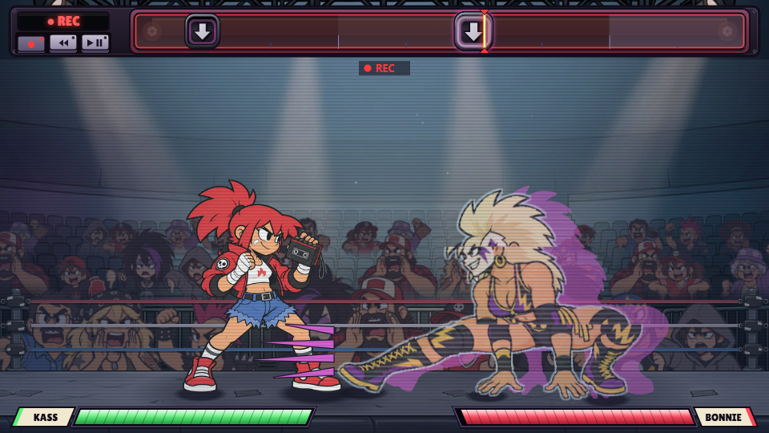
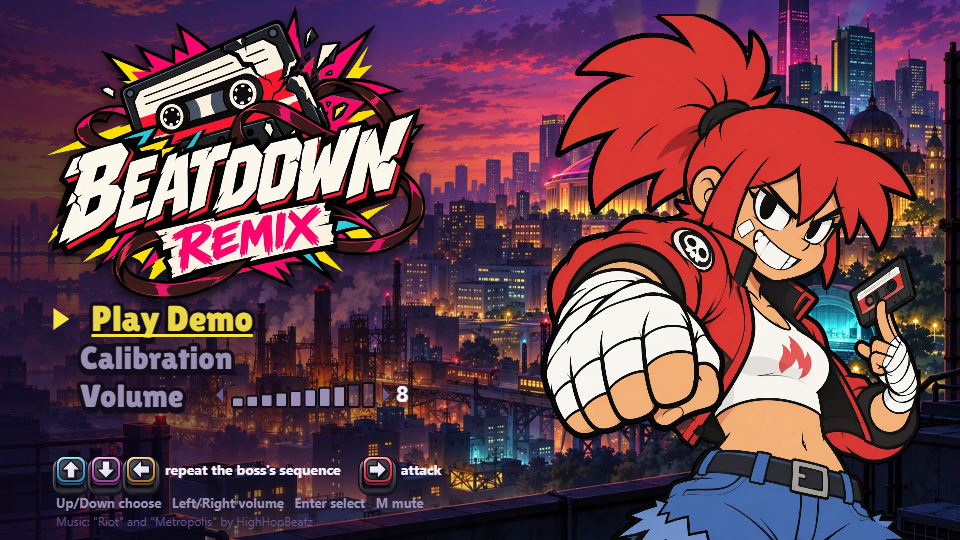
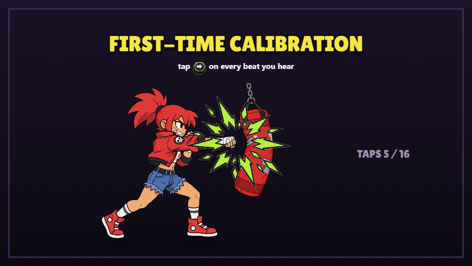
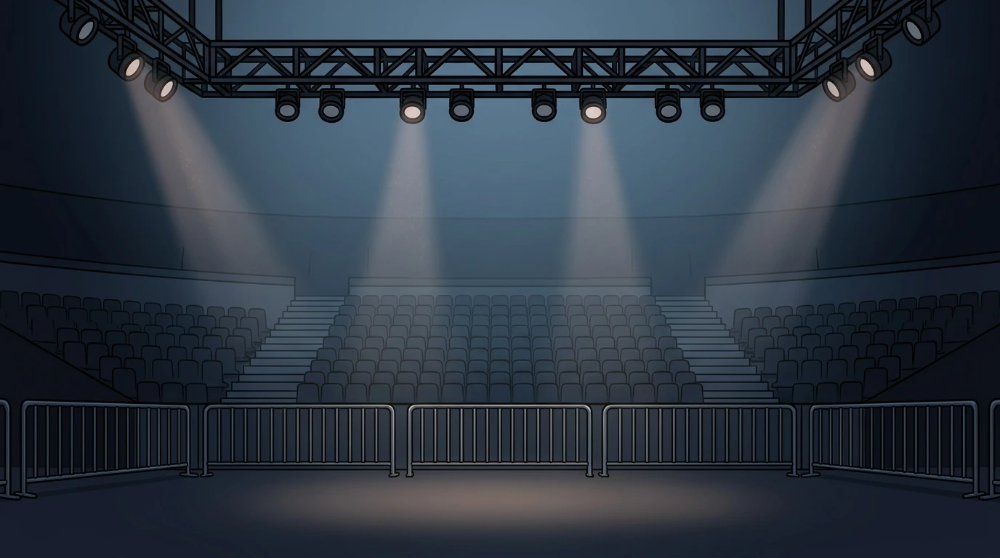
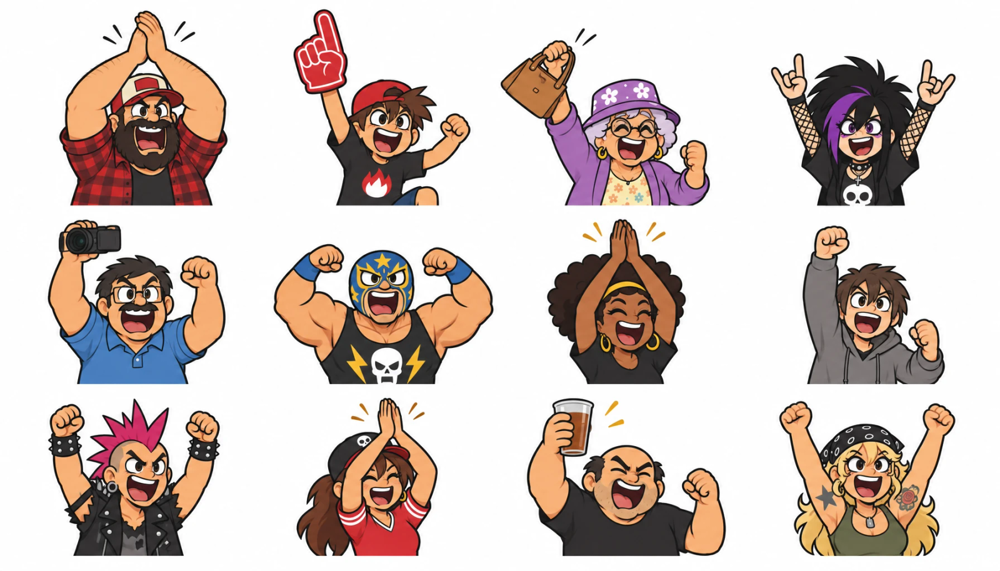
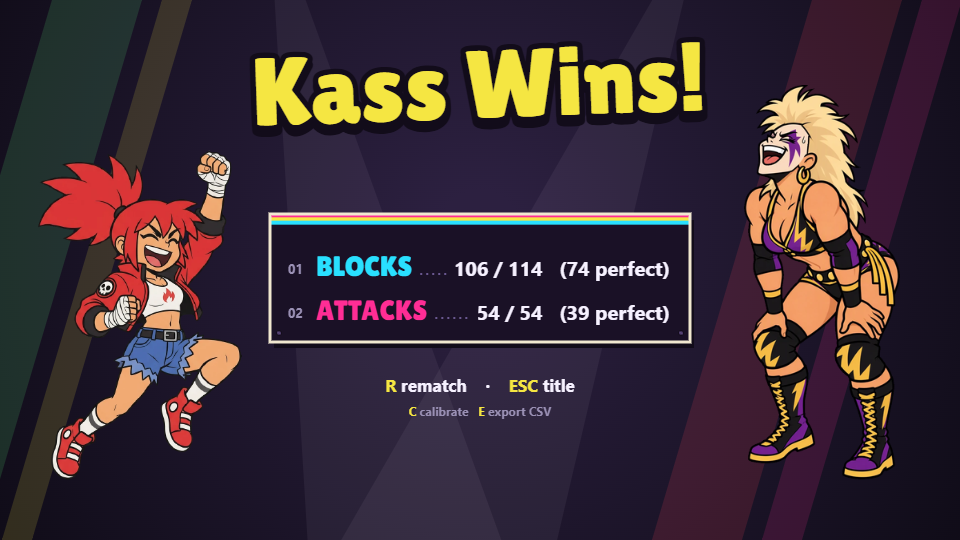

<!-- MEDIA: clips and stills are captured from a human-like autoplay run of the real game (BEATDOWN REMIX repo, `?autoplay=human`). Catalog: docs/media-beatdown-remix.md -->

<figure class="media-hero">
  <video src="/game-design-portfolio/media/beatdown-remix/hero-loop.mp4" poster="/game-design-portfolio/media/beatdown-remix/hero-loop.jpg" autoplay muted loop playsinline preload="metadata" aria-label="Bonnie performs a phrase of strikes, the tape rewinds, and Kass answers each strike on the beat."></video>
  <figcaption>One phrase: Bonnie performs it, the tape rewinds, Kass answers it.</figcaption>
</figure>

PaRappa the Rapper is the game that kicked off the rhythm genre as we know it, and it was also the first rhythm game I ever played. I still love it. I wanted to make a call-and-response game in its spirit, with characters and a story worth caring about, but where answering the boss feels like a fight.

In PaRappa you answer by rapping; I wanted the answer to be physical. Here the boss throws a string of strikes and you block each one back, in the same order, on the beat. The demo is one full fight against Bonnie Boomin', a wrestling heel, to a three-minute song.

<a href="https://awkner.itch.io/beatdown-remix-demo-v01?secret=3i41o6UZr8OhftGm1uuZ3A2P3DU" rel="noopener" target="_blank">Play it in the browser on itch.io</a> (keyboard, desktop).

## How it plays

The song is cut into phrases of 2, 4 or 8 beats, and each phrase plays twice. First Bonnie performs it: every strike shows up as an arrow on a tape strip at the top, and nobody takes damage. Then the tape rewinds for one beat while the music keeps going. Then the same strikes come back at the same times, and you press the matching arrow to block each one.

Kass, the player, has 100 health. A missed block costs 13; a good block wins some back (12 for a Perfect, 9 for a Good). Scattered misses don't kill you, a streak does. The right arrow is also the only attack: a finisher on the last beat of every answer, plus a bonus hit right after it if you blocked at least two strikes perfectly.

The first half of each phrase is drawn as a recording. The stage goes cold and scanlined, a REC tag blinks on the beat, and Bonnie turns into a projection, because what you're watching hasn't happened yet. The answer starts on a hard cut back to full colour. The one rule I set before drawing any of it: the arrow colours and the timing have to read through the effect.

<figure>

  <figcaption>Bonnie's turn, on tape. The cover above is Kass's turn.</figcaption>
</figure>

## The first version asked too much

The September version was a fighting game on a fixed pulse: Bonnie threw a light hit on every beat, telegraphed heavy hits you had to dodge, and you had parries, ripostes and a stagger bar on top. I wrote it to answer one question: could someone with no tutorial read the pulse and four different tells in sixty seconds?

Playing it, the answer was no. You had to learn the rules before you could do anything, and Bonnie's moves were something to decode rather than something to answer. In November I started over with call and response, which puts the reading first: Bonnie shows you exactly what's coming, so the challenge becomes memory and precision instead of guessing. I archived the old code rather than deleting it.

## Ending the fight

This took three tries.

The first had Bonnie at 300 health and every hit doing damage. I wrote a script that plays the real game with bot players at different skill levels, and it showed about a 3x spread in damage between them: good players finished the fight halfway through the song, weak ones never finished it at all.

So I took her health bar away. Your hits added up to a score, and the score picked the ending (a draw, a T.K.O. or a K.O.). Kass couldn't lose. Every player got an ending that matched how they played, and for a prototype meant to measure things, that was fine.

It stopped being fine once I decided to put a demo in front of people. A fight you can't lose isn't a fight. Now the song decides how long the fight is and Kass's health decides the stakes: survive to the end for a T.K.O., land every note Perfect for a flawless K.O.; if Kass's health runs out, Bonnie wins while the music keeps playing. Below 30% health the screen edges pulse red on the beat. The simulation now reports how long each kind of player survives and the shortest miss streak that kills, and that's where the 13 / 12 / 9 numbers come from. For the last pass I added anonymous telemetry to a playtest build (no personal data) and had friends play it remotely.

Along the way I cut a stagger system that worked. Filling a bar stunned Bonnie and gave you a short freestyle section, graded against the beat so mashing paid almost nothing. But the freestyle skipped phrases of the chart, and those phrases still counted toward the best possible score, so it was competing with the thing the game was measuring. The code is still there, switched off.

## Twists without new buttons

My first ideas for Bonnie's tricks were a referee, a ghost and a cutscene, each of which needed new rules and new art. I dropped them and kept her tricks to one rule instead: the controls never change, only the rhythm and what you're allowed to see. One twist per section of the song, and never two in the same phrase, so each one can be learned before the next arrives.

  <figure>
    <video src="/game-design-portfolio/media/beatdown-remix/clip-walking.mp4" autoplay muted loop playsinline preload="none" aria-label="A note with a marked border dashes half a beat to a new slot, and Kass blocks it at the destination."></video>
    <figcaption><strong>Feint.</strong> Trust the border, not the movement: press where it lands.</figcaption>
  </figure>
  <figure>
    <video src="/game-design-portfolio/media/beatdown-remix/clip-claps.mp4" autoplay muted loop playsinline preload="none" aria-label="Crowd hands fill the tape lane and close on every beat, hiding which slots hold notes."></video>
    <figcaption><strong>Claps.</strong> The crowd hides the arrows on every beat; play the rhythm you saw.</figcaption>
  </figure>

**A feint** is a note with a marked border. On its beat it dashes to a slot half a beat later, and that's where you press. My first version slid along with the playhead, and in playtests it read as a hold note. It became a quick dash with its own whoosh, starting exactly on the original beat, so you have to trust the border instead of reacting to the movement. Pressing at the starting slot counts as "fell for it": a miss that uses up the note.

**The claps** went through more versions than anything else. Hiding the arrows as Bonnie struck was too hard. Hiding half a phrase under a clap icon worked, so I tried hiding every note, and memory turned into guessing; I backed off. Putting a hand over each hidden note still gave away which slots had notes, so in the final version the whole lane fills with hands that close together on every beat, and you play the rhythm from memory.

*The fight follows the song's real breaks, not Bonnie's health. Section 1 teaches her three moves with everything visible, then come feints, claps, and both alternating in the finale. 114 notes in all.*

## Every opponent plays differently

The loop is the same in every fight, but each opponent gets a few mechanics of their own, the way every PaRappa boss has their own song. Bonnie is a wrestling heel, so her tricks are cheap ones: feints and a crowd that covers your eyes. Count Valse and Maestro Molotov each have a character, a stage and a full set of poses, and I built a looping scene of each one on the game's own renderer to check their mechanics show up on the tape.

  <figure>
    <video src="/game-design-portfolio/media/beatdown-remix/valse-loop.mp4" autoplay muted loop playsinline preload="none" aria-label="Count Valse in waltz time: the tape is split into two bars of three beats, and the third beat of each bar is an attack."></video>
    <figcaption><strong>Count Valse</strong>, a ballroom instructor who fences, wants one partner who can count to three. His fight is in waltz time: block, block, attack in every bar, with the tape split into two bars of three.</figcaption>
  </figure>
  <figure>
    <video src="/game-design-portfolio/media/beatdown-remix/molotov-loop.mp4" autoplay muted loop playsinline preload="none" aria-label="Maestro Molotov: a hold note drawn as a burning fuse; Kass braces while it burns and dodges as the bomb goes off."></video>
    <figcaption><strong>Maestro Molotov</strong>, a conductor banned from using real cannons, brings his own. His long notes are fuses: you hold to brace while it burns and let go to dodge just as the bomb goes off. He also throws firecracker strings, fast runs on a single arrow.</figcaption>
  </figure>

## Feedback on the press, not the verdict

In an early playtest the game felt off the beat, and it took me a while to see why: every hit effect fired when the game finished judging the press, about 170 ms late. Now every sound, effect and pose fires on the press itself. Strike effects take the colour of the arrow, and Kass's anticipation frames play ahead of time so her hit frame lands on the beat.

The same rule killed the miss sound. The game can only be sure you missed 110 ms after the beat, and any sound that late felt wrong, so a miss is now visual only.

## The story

Kass is chasing her stolen mixtape through an underground fight circuit, and Bonnie has a song from it. The tone is Scott Pilgrim: absurd situation, sincere characters. The dialogue plays over the stage in the gaps of the song, so the music never stops for it.

<figure>
  <video src="/game-design-portfolio/media/beatdown-remix/clip-intermission.mp4" autoplay muted loop playsinline preload="none" aria-label="Bonnie and Kass trade lines in speech bubbles over the stage as the opening runs into the song."></video>
  <figcaption>The opening runs straight into the song.</figcaption>
</figure>

My first draft ended with Bonnie turning good. I cut it: she works better as a heel who's having the time of her life, right to the last line.

Art and front end

  <figure>

  <figcaption>Title screen.</figcaption>
  </figure>
  <figure>

  <figcaption>Calibration: 16 taps on the beat while Kass works a heavy bag.</figcaption>
  </figure>

*Bonnie's poses. Her three strikes are only there for variety; the game never tells you what each arrow means.*

*I tried a cut-out rig for the strikes. A flat cut-out can't twist a three-quarter torso, so the punch came out weak (left). I went back to one drawn frame per strike plus an anticipation frame (right).*

*The arena. No text anywhere in the background, so nothing competes with the tape.*

*One of three crowd sheets (neutral, booing, hyped). I edited the other two from the neutral one.*

*Results.*

## Where it stands

A one-boss demo that runs in the browser: title menu, calibration, one fight on "Riot" (107 BPM, 31 phrases, 114 notes), two twists, the dialogue, two endings (T.K.O. and flawless K.O.) plus a loss, results and pause. The game rules run separately from the rendering, with 1,617 automated tests.

Friends have played it, but nobody has played it cold yet. That's next, with three questions I can't answer by myself: do two-bar phrases fit in memory at this tempo, is one beat of rewind enough, and do the claps read.

Music: "Riot" and "Metropolis" by HighHopBeatz. Crowd sounds: Mixkit. Hit layers: CC0 packs from OpenGameArt. Fonts: Lilita One, Comic Neue, Patrick Hand (SIL OFL).
