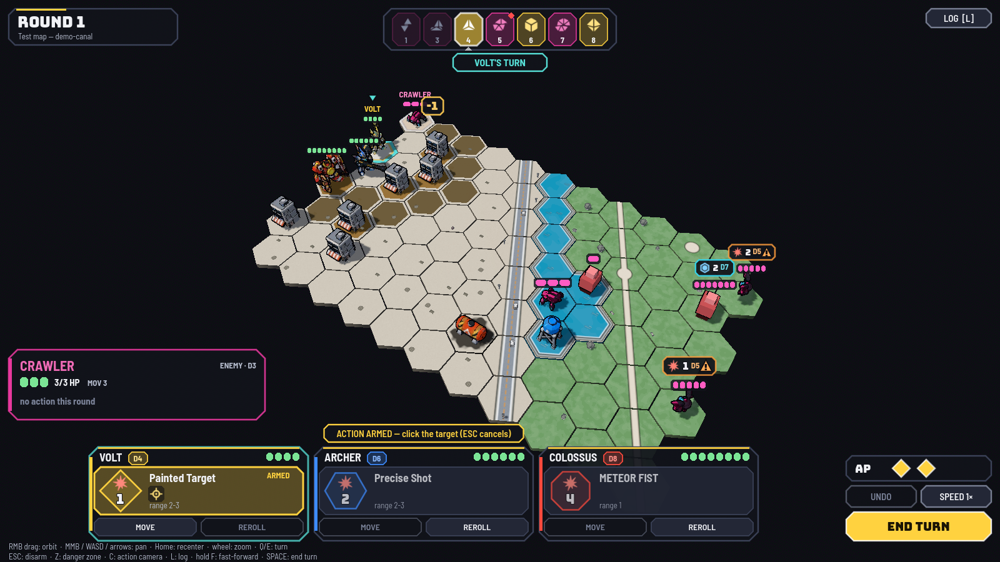
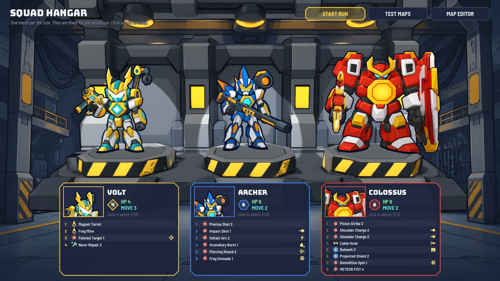
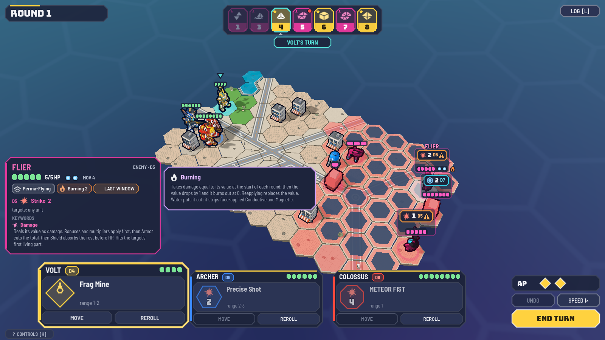
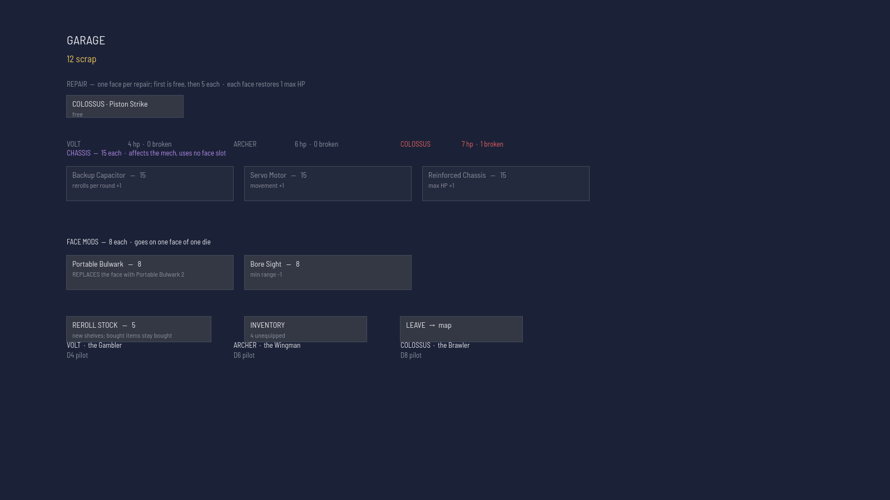
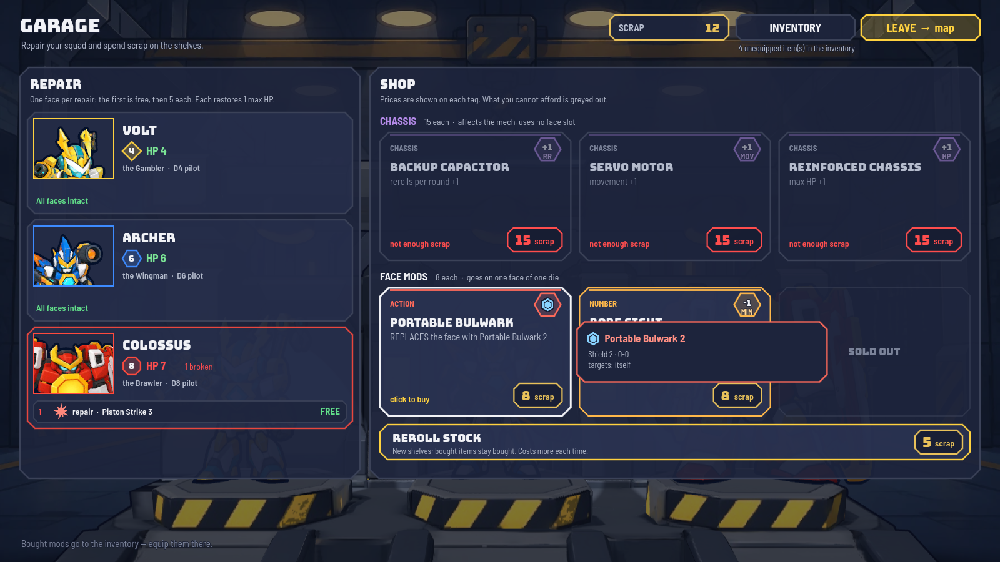
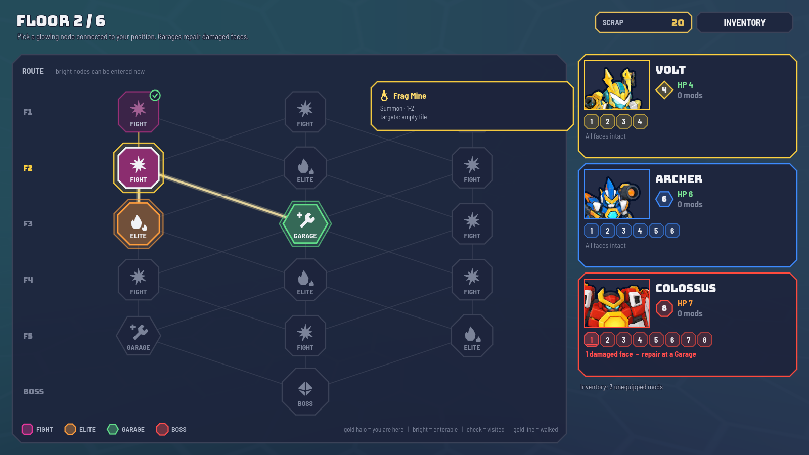

## The problem

Tactics games with a roguelike structure usually fill their depth with hand-written card or ability text. Every new unit means new special cases, and the player memorises exceptions instead of reading a board.

I wanted a tactics game where depth comes from a few pieces that combine by themselves, and where the enemy's intent is readable before you act.

## Goals / pillars

- **Dice as actions.** Each mech has one die (D4, D6 or D8). The face that rolls is the action for the round.
- **Systemic by rule.** Adding a tag must never require hand-coding its interactions. Anything that needs "...but only on a shield face" is content, not a system.
- **Dominate the luck, don't fight it.** The enemy shows its face before it acts. Reroll is an honest gamble, and undo cannot be farmed for a better roll.
- **Super Sentai tone.** Chibi mechs, a cartoonishly wrecked city, a name on every move.

## Process & iterations

Each story below is a version, what the evidence said, and the change. Evidence is my own playtesting and a bot bench that plays full matches headless. No outside playtest has happened yet.

### 1. Initiative: from a per-face clock to the size of the die

**Version.** Every enemy face carried a hand-tuned "tick" (0 to 6), and each player gesture advanced a clock.

**Change.** I replaced it with one rule: the round runs in ascending order of die size. A D3 acts on 3, a D8 mech on 8. Even sizes are the player, odd sizes are enemies, so the two sides never share a slot. A two-part boss (D9 core, D5 plating) simply enters the order twice. The tick field and its 17 hand-set values are gone.

How I got there: the earlier version and the evidence

It had been measured and played. A side effect: repositioning could cost you an enemy attack.

**Evidence.** The tick was only read on the enemy side. A player-side mod that changed it did nothing visible, so I removed that mod as dead.

### 2. The Fuel Tank: read the state, not the damage type

**Change.** Death outcomes became data: a list of outcomes with a radius, damage, spilled terrain and an optional condition. This also gave a clean answer to "is it the ground that burns?" Terrain only holds terrain properties, and oil is what is flammable, not the tile. A tank parked on burning oil catches fire, so pushing it into a fire arms it. I wrote no rule about pushing; it emerges from the others.

How I got there: the earlier version and the evidence

**Version.** My spec for the tank: hit by Burning damage and it explodes for 3 in radius 1. Hit by anything else and it only breaks and spills oil. But the game no longer had damage types. I had removed them two days earlier, because only one rule in the whole game read them.

**Evidence.** Rather than bring damage types back, I asked what the player can see on the board: was the tank burning when it broke? That needs no new plumbing.

A later check found an incendiary face killing a 1 HP tank before its Burning applied, so it spilled instead of exploding. The rule became: states a damage face writes land before that face's damage.

### 3. Push and Pull: two clicks

**Change.** Click one picks the target, click two picks the destination tile. The path comes from the line-of-effect calculation, and the fine aim inside the hex picks which way the target travels. Between two directions that both push away, the player now chooses: break the next ally's range, or drop the target on a mine.

How I got there: the earlier version and the evidence

**Version.** One click, with the destination decided by an internal rule.

**Evidence.** Four rounds of testing broke assumptions that the AI assistant had made while implementing it. The hex line alternates direction past distance 2, so the default sent an Archer to the wrong column. The preview did not redraw inside a hex, so you could see one path and execute another. That broke the rule that preview and execution come from one function.

*Armed action: valid tiles light up and the enemy card is open before you commit. This is the "preview and execution use the same function" rule in play. Capture from 9 Nov 2026, so the background is the older dark one.*

### 4. The endless matches that were only long matches

**Version.** A sweep of 2,400 bench matches hit the 15-round cap 74 times.

**Change.** A test that asserted zero capped matches was really asserting pacing. It became "95% of matches finish within 15 rounds" (profile Equilibrado). Conclusions now have to hold across three bot profiles before I call them about the game and not about the bot.

How I got there: the earlier version and the evidence

I assumed the bot refused to kill a 1 HP enemy that explodes, because its fear term counted the explosion as self-damage.

**Evidence.** The fear hypothesis was not supported in the one bot profile I ran (Equilibrado, 20 Aug): that enemy lost no HP in either configuration. A first "clear line" measure seemed to point at cover, but it cannot separate the map geometry from the bot's own choices, so I suspended the cover reading until the three-profile panel has run on it. Then my own question ("is it the bot, or the encounter?") led to the confirmed part: given 40 rounds instead of 15, 58 of the 74 finished by themselves. Only 16 of 2,400 (0.7%) were true stalemates.

## Design artifacts

Show the design artifacts (5 images with captions)

*Squad Hangar: one mech per die size, with every face listed. Decision shown: the die is the loadout, and it stays fixed for the whole run.*

*Inspecting an enemy: its face is public, and a tooltip explains Burning. Decision shown: the enemy's intent is readable before you act.*

*Garage before the UI pass: correct information, hard to scan.*

*Garage after: costs, what each item grants and the repair state are readable at a glance.*

*The run map: a route of fights, elites and garages, with a damaged face shown on the Colossus card.*

## Result

A playable prototype from squad select to map, combat, reward, garage and inventory. The rules live in a pure C# core with no engine code in it, so the bench can play full matches headless. Nine mechs (54 faces) exist, three of them with 3D models, plus one elite, one boss and 23 mods.

Bench numbers, with profile and date: the combat curve by floor measured 142, 118 and 111 wins out of 200 (71%, 59%, 55.5%) with profile Equilibrado on 22 Aug 2026. The three-profile panel showed the same downward trend in every profile. Those are raw bench readings, not tuned balance.

Process results: an audit of 25 claims in my own design doc found 9 were false against the code, which led me to the rule "the code beats the design doc". Decided rules now go into a ledger with a guard test each.

## What I learned / what I'd do next

- **Distrust the instrument first.** A bot paralysed by a leaked setting once measured 58/200 instead of 195/200. I now reset bot knobs in every bench class and test that they are reset.
- **Cost of a re-measure is never an argument for an exception.** I turned down a "just exclude the enemy shield" shortcut for that reason.
- **Not validated:** feel, difficulty and readability with players who did not build it. The bench uses scripted bots, and the balance numbers are early. I want a blind playtest before tuning anything.
- **Known gaps:** two confirmed bugs are parked (burning oil that never goes out, and factory-magnetic pairs re-stunning each other). The "die built over the run" pitch is not what the code does: a run modifies existing faces with mods and chooses which mechs to bring, but never adds faces. I describe it that way on purpose.
- **Next:** record the combat footage, run the blind playtest, then decide the number of floors before rebalancing the danger budget.

## Credits

Design: Bruno Santos Briseno. Code and doc drafting: Claude (AI assistant), from my specs. Fire and explosion flipbook VFX use a non-commercial licensed set and would be replaced with original art before any commercial use.
