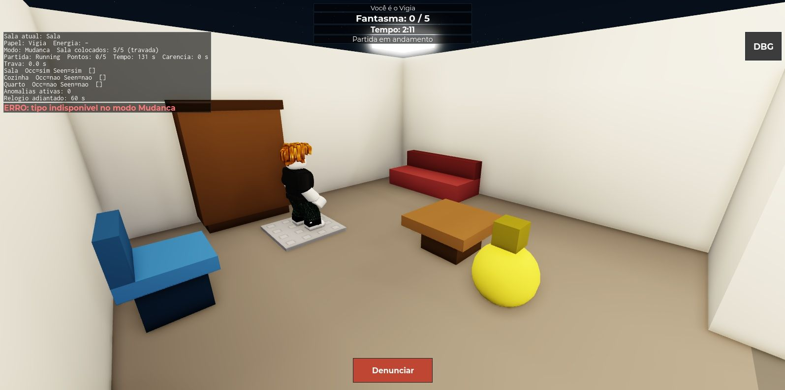
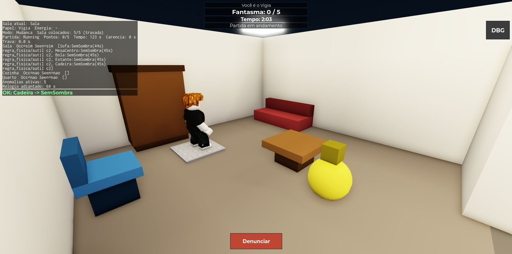
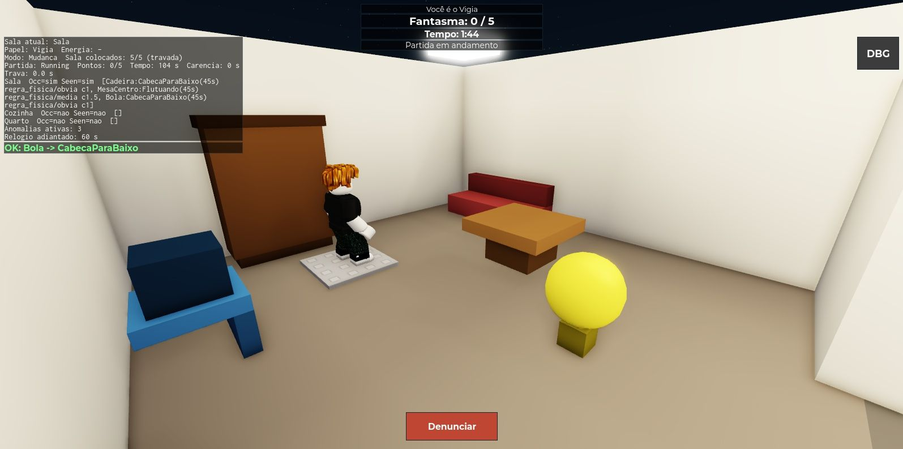
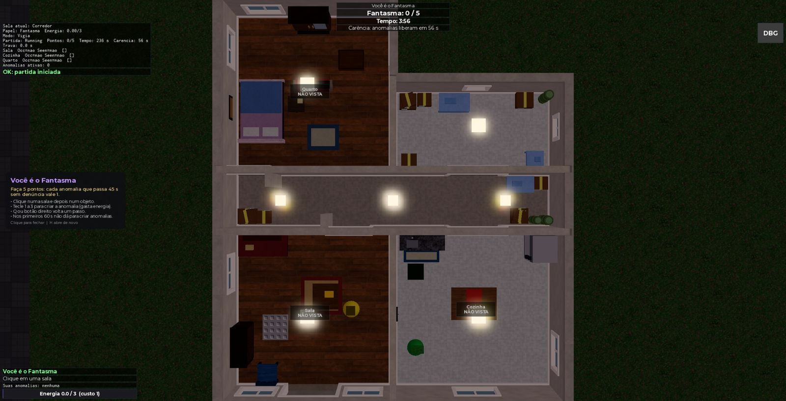
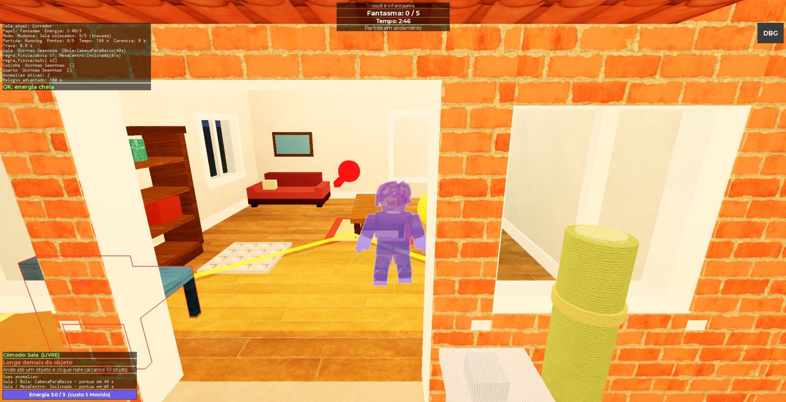
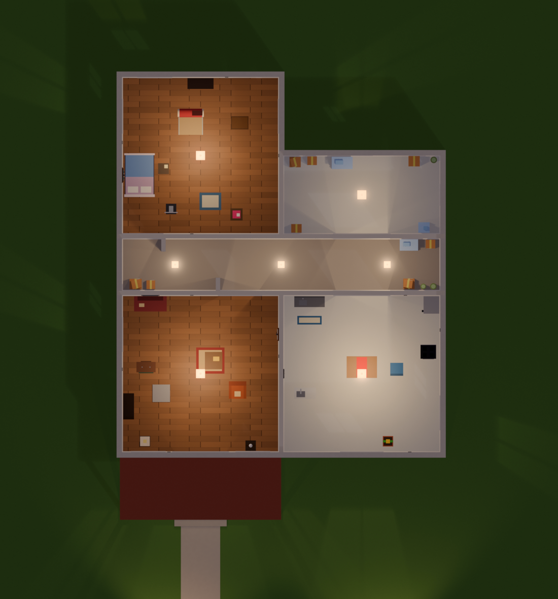
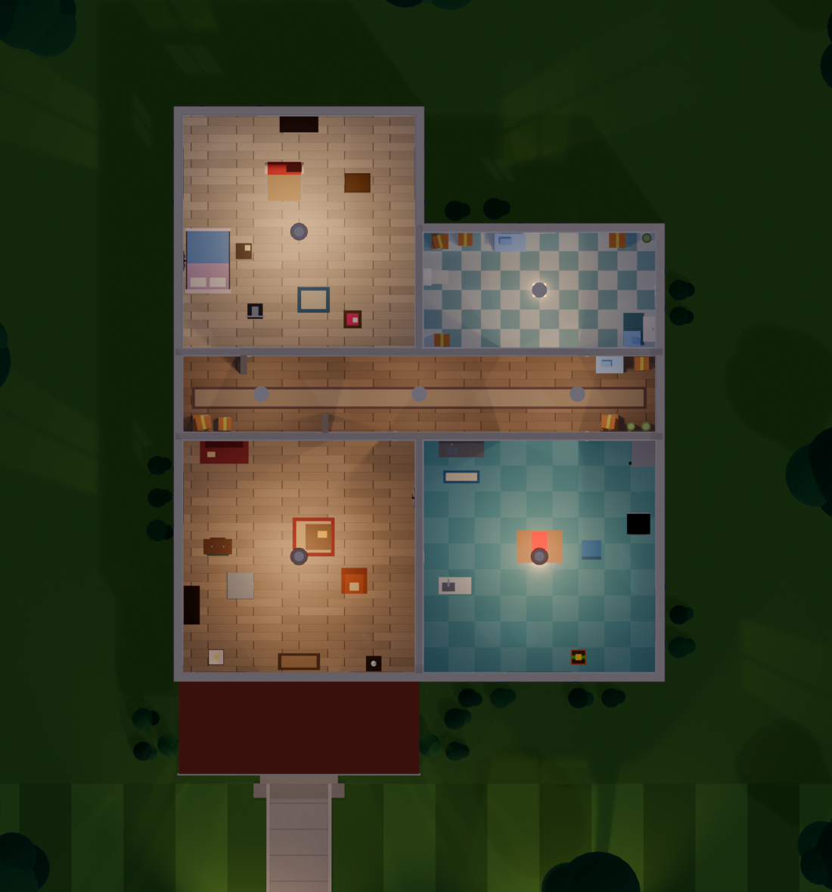

## The problem

Anomaly games on Roblox generate their anomalies with a system. I asked what happens if a player is the anomaly, live. And what if the rest of the round is real work instead of just staring?

## Goals / pillars

The log never lists pillars. These five are reconstructed from decisions I locked.

- **The house only changes when nobody looks.** "Looking" is a server-verified rule, not just being in the room.
- **Divided attention.** Watchers carry, assemble and install. Working zooms the camera in, so work costs vision.
- **The server decides, and nothing leaks.** No data the Watcher receives changes when an anomaly exists.
- **Anomalies read by physical rule.** Upside down, floating or tilted needs no list or memory.
- **No arbitrary rules inside the fantasy.** Everything on the floor belongs to the house.

## Process & iterations

My evidence is automated rules tests, review by a second agent, Studio playtests driven by an agent, and my own play. I am the only human who has played it.

### 1. "No shadow" replaced by "Tilted"

**Version.** One subtle anomaly type was an object that loses its shadow.

**Evidence.** In the Studio test, five objects with the shadow removed looked identical to the normal room. Shadow quality also depends on each player's graphics setting, so it would be unfair.

**Change.** I replaced it with a 12 degree tilt. Rule: anomalies must be readable at a glance on any device.

*Normal room, early blockout (Studio capture, 8 Nov). Debug overlay and Portuguese UI visible.*

*Five objects altered by "no shadow": indistinguishable from the first image. Decision: drop the type.*

*Upside down and floating, by contrast, read instantly. Decision: anomalies come from physical rules.*

### 2. The Ghost stops watching from above and starts to walk

**Version.** The first mode gave the Ghost a top-down view. It clicked a room, an object, then a type, and Watchers reported with a type and an object.

**Evidence.** The top-down camera made the Ghost a menu, and "room occupied" was a poor stand-in for looking. I decided the Ghost should walk, so that space and time become a cost for him.

**Change.** In "The Change" mode the Ghost walks the house, invisible to Watchers, with no collision and no walking through walls. He sees Watchers through walls, plus vision cones and outlines on objects (red: seen now, orange: seen a moment ago). Looking became a rule with the camera frustum, nine points per object, wall-aware rays and 1.5 s of memory.

*Legacy mode: Ghost sees the house from above and clicks rooms. Studio capture, Portuguese UI.*

*Current mode: the Ghost walks in person, with energy and anomaly controls at the bottom left. Studio capture with debug overlay.*

### 3. "Same answer": no free detector

**Version.** Checks the Watcher could trigger without paying the touch cost (drop preview, refusal messages, reach) answered differently for altered and normal objects.

**Evidence.** Agent reviews found leaks such as a street-light shadow that gave away a moved object, and a reference pose handed to the client. Each one was a free detector.

**Change.** Every check now answers identically for normal and altered objects. The Ghost's own position leaks through eleven side channels (body, shadow, name, footsteps, chat bubble and others), which I closed or listed. Footstep sound is handled in code but has never been heard in a real session.

### 4. A game of work, and the rejections that shaped it

**Version.** After the extra-mechanics rounds, the game was "tidy first, then watch". Arriving at it was a scope cut of a cheap test that quietly became design, which is a mistake I should have marked as temporary.

**Evidence.** I rejected three agent proposals because they were arbitrary: "there is no dropping", a teleport back to the pile, and "accepting the change" as a neutral choice.

**Change.** Continuous tidying: Watchers carry boxes and install items with gestures while anomalies appear. Touching an altered object before correcting it gives the Ghost a point and a random curse. Fixed furniture is "too heavy", not a special rule.

*Before the art pass (Blender render, not an in-game capture).*

*After the art pass (Blender render, not an in-game capture). Decision: playable furniture keeps its colour, so contrast against the wall is what makes an anomaly visible.*

## Design artifacts

The design log has 53 sections of decisions, tests and problems. It also holds a list of 42 design problems with solutions and status and a hook filter (peak, hands, dilemma, story, depth). The figures above are the artifacts I can show today.

## Result

A playable Roblox prototype with about a dozen gameplay systems, 4 anomaly types, 5 curses, a 14-item delivery catalog, a spectator role and a debug and bot harness. About 29 test files check the pure rules, and 31 adversarial review rounds found about 220 issues. A bot-driven audit found 0 violations in about 24,000 checks. All balance numbers (300 s match, 25 s grace, 45 s to score, energy costs) are first guesses.

## What I learned / what I'd do next

- **Defining "looking" is the hard part.** It broke on doorframes, ceiling cameras and street-light shadows, until I replaced "being in the room" with a rule of its own.
- **Rejecting is design.** Each refusal swapped an arbitrary rule for one that makes sense in the fiction.
- **A rule is only resolved when the engine runs it.** Two fixes I counted as solved failed in Studio.
- **Not validated:** fun, tension, balance, how it looks in real Roblox, sounds, and mobile. No one but me has played it. A 19-hypothesis playtest kit is written and has not been run.
- **Next:** run the playtest with 2 to 4 people, record real 3D footage, then tune numbers.

## Credits

Design direction: Bruno Santos Briseno. Research, ideas and code: Claude (AI assistant), with a separate reviewer agent. Sound effects come from third-party packs (DailySoundsFX, ProSoundEffects, APMOfficial). I have not verified the licence terms outside the Studio.
